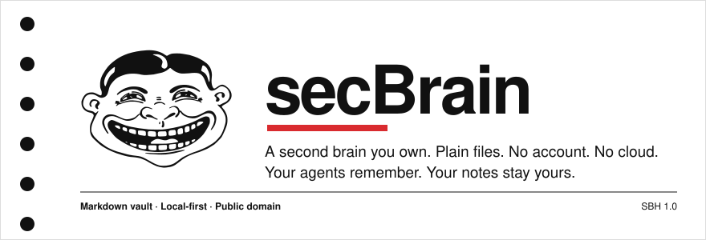
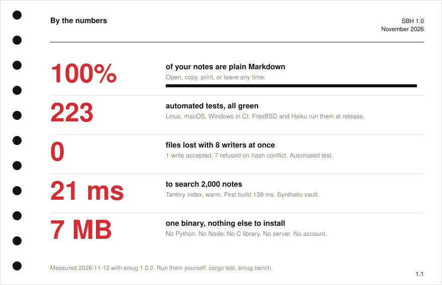
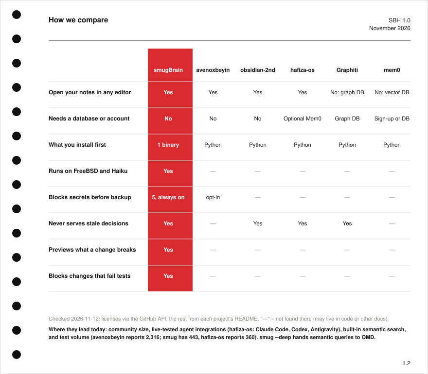

<p align="center"></p>

<p align="center">
<a href="https://github.com/OnurByte/smugbrain/releases/latest"></a>
<a href="https://github.com/OnurByte/smugbrain/actions/workflows/ci.yml"></a>


</p>

# smugBrain: local-first memory for AI coding agents

**smugBrain** gives Claude Code, Codex and Hermes a memory you own: plain Markdown notes plus one small binary, `smug`. It records decisions **with their sources**, never returns a decision that has been replaced, shows you **what a change will break before you make it**, and refuses to apply it if your own test questions start failing. No account. No cloud. No telemetry. Nothing to compile. Public domain.

Better than your brain. Objectively.

## Install

Prebuilt binaries are on the **[Releases page](https://github.com/OnurByte/smugbrain/releases/latest)**. Or paste one line; the installer verifies the SHA-256 before it installs anything.

macOS, Linux (x86-64, ARM) and Haiku:

```bash
curl -fsSL https://raw.githubusercontent.com/OnurByte/smugbrain/main/install.sh | sh
```

FreeBSD (uses the built-in `fetch`; with `curl` installed the line above works too):

```bash
fetch -qo - https://raw.githubusercontent.com/OnurByte/smugbrain/main/install.sh | sh
```

Windows (PowerShell):

```powershell
irm https://raw.githubusercontent.com/OnurByte/smugbrain/main/install.ps1 | iex
```

Then:

```bash
smug init my-brain        # new vault: folders, rules, .gitignore
cd my-brain
smug setup claude         # Claude Code starts every session with your memory
```

## What it does

```bash
smug search rust karar                 # find notes; replaced decisions never come back
smug decide postgres --source adr-7 --topic db < why.txt    # a decision, with its source
smug check postgres                    # CURRENT / STALE / CONFLICTED / UNSUPPORTED
smug fail retry-loop --method "retry forever" --reason "hammered the API" < /dev/null
smug warn "let's retry forever"        # it has failed before, here is why
smug at 2026-11-03 database            # what was valid and known on that day
```

**Change a decision safely**

```bash
smug patch postgres --new-id cockroach --source adr-9 < why.txt   # proposes, applies nothing
smug impact postgres                   # every note that depends on it
smug eval 1                            # your questions, before and after the patch
smug apply 1                           # refuses if a question that passed now fails
```

Everyday safety: `smug write note.md --expect <sha256|new>` (atomic; refuses if the file changed under you), `smug backup` (scans exactly what is staged, stops on any secret), `smug doctor` (health check and crash recovery), `smug bench` (recall, MRR and latency on your own cases). Full list: run `smug` with no arguments.

## Numbers

<p align="center"></p>

## Compare

How smugBrain compares with avenoxbeyin, obsidian-second-brain, hafiza-os, Graphiti and mem0. Facts come from each project's own repository and README, checked 2026-11-12. They lead in places and the card says where.

<p align="center"></p>

## FAQ

**What problem does it solve?** AI agents forget, and worse, they confidently use decisions that were replaced months ago. smugBrain keeps every decision with a source and a validity window, and refuses to hand a stale one back.

**Does it need the cloud, an account or an API key?** No. It makes no network calls. Your notes are Markdown files in a folder.

**Does it work with Obsidian?** Yes. The vault is a normal Obsidian-compatible folder; `[[wikilinks]]` count as dependencies in `smug impact`.

**Which agents does it support?** Claude Code has native session and prompt hooks (`smug setup claude`). Codex follows the `AGENTS.md` that `smug init` writes. Hermes and any other agent with a terminal can call `smug context` and `smug hook prompt`.

**How is it different from Mem0, Graphiti or a vector database?** Those store memories in a database or service. smugBrain keeps Markdown as the only source of truth, so you can read, diff and back up your memory with git, and its index is disposable.

**Is it safe to back up?** `smug backup` scans exactly what is staged and stops on private keys, tokens, API keys, `password:` lines and recovery phrases. Anything secret-shaped belongs in `.secrets/`, which is never committed or indexed.

**Is it really a single binary?** Yes: about 7 MB, pure Rust (redb for state, Tantivy for search), no Python, no Node, no C library, no server.

**Does it search by meaning?** Built-in search is keyword search with Turkish-friendly folding (`isik` finds `ışık`). `smug search --deep` hands the query to [QMD](https://github.com/tobi/qmd) for semantic search when you have it installed.

## Under the hood

Markdown notes. State in [redb](https://github.com/cberner/redb), search in [Tantivy](https://github.com/quickwit-oss/tantivy). Every write is journalled to `history/events.jsonl`, which lives in git: delete `.smug/` and nothing is lost. Guarantees, data formats and limits: [docs/design.md](docs/design.md). Release history: [CHANGELOG.md](CHANGELOG.md).

## Limits

- `eval` measures what retrieval returns for your questions, not what a model answers.
- `bench` runs on your own cases; there is no independent public benchmark.
- Codex and Hermes have no native lifecycle hooks in smug.
- `smug feedback` is recorded by you or your agent, not inferred.

## Contributing

Pull requests, bug reports and test cases are welcome: see [CONTRIBUTING.md](CONTRIBUTING.md). Good first contributions: a test for a platform quirk, a new secret pattern with a test, an agent adapter.

<a href="https://github.com/OnurByte/smugbrain/graphs/contributors"></a>

## License

Public domain ([Unlicense](LICENSE)). Contributing: [CONTRIBUTING.md](CONTRIBUTING.md). Security: [SECURITY.md](SECURITY.md). Design: NASA Graphics Standards Manual NHB 1430.2 (1976).
