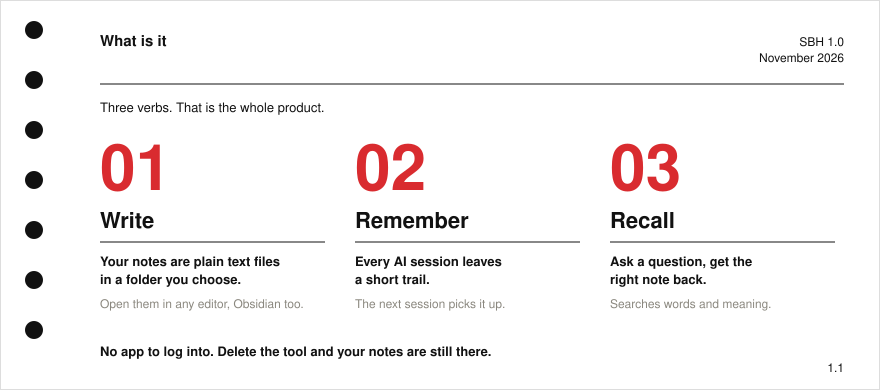
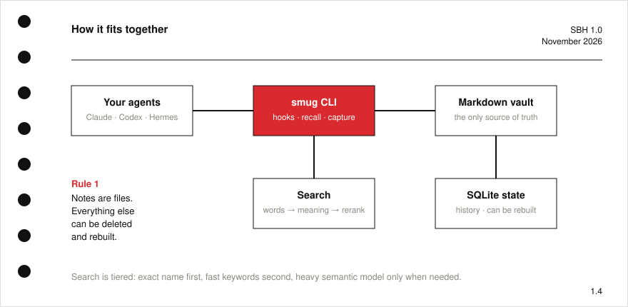
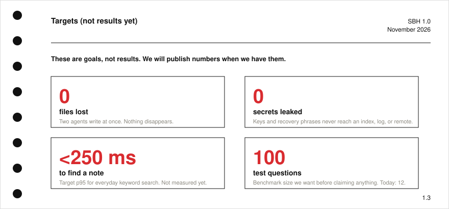
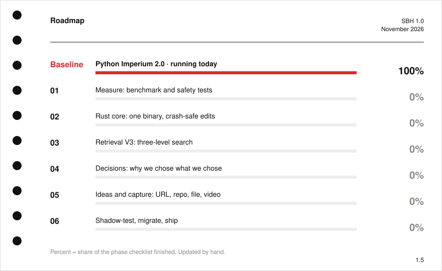
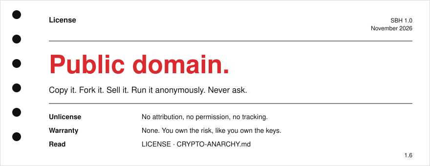

<p align="center"></p>

<p align="center"><a href="README.tr.md">Türkçe</a> · <a href="LICENSE">Public domain</a> · <a href="CRYPTO-ANARCHY.md">Crypto-anarchy statement</a></p>

**secBrain** is a second brain for people who work with AI agents and don't want to rent their memory from a company. It is a folder of Markdown notes plus a small toolkit that lets Claude Code, Codex and Hermes remember what you did yesterday, find the right note, and back everything up without leaking secrets.

If you can use a text editor, you can use it.

<p align="center"></p>

## Why

Most "AI memory" products keep your notes on someone else's server and break when the company changes its mind. secBrain keeps one source of truth, a folder you own, and treats every index as disposable.

<p align="center"></p>

## Numbers

Real numbers from the author's reference vault, measured 2026-11-12. Nothing here is rounded up.

<p align="center"></p>

What we are aiming for next. These are **goals**, not results:

<p align="center"></p>

## Roadmap

<p align="center"></p>

The plan: keep the Markdown vault and the existing QMD search, add a Rust core (`secbrain` CLI, SQLite for history and indexes), and prove every step with a benchmark before claiming it is better. Details in [docs/roadmap.md](docs/roadmap.md).

## Start

```bash
git clone https://github.com/OnurByte/secBrain.git my-brain
cd my-brain/template        # the empty vault: folders + rules
```

Open `template/` in Obsidian (or any editor). Read `template/CLAUDE.md`, the rules your agent follows. That is the whole setup for now; the automation scripts are still being cleaned before they go public.

## Folders

| Folder | What goes there |
| --- | --- |
| `000-inbox` | Raw captures, links, half-thoughts |
| `100-command-center` | Dashboard, what matters now |
| `300-projects` | One note per project |
| `500-knowledge` | Things you learned, with sources and dates |
| `600-arsenal` | Tools, resources, ideas |
| `850-companion` | The agent's memory: who you are, last session, open threads |
| `900-archive` | Old stuff. Never used as evidence |

## License

<p align="center"></p>

Design language: NASA Graphics Standards Manual NHB 1430.2 (1976): Helvetica, one red, hairline rules, punch holes. Icon vectorised from a supplied bitmap (provenance of the original art unverified: replace it if you need clean rights). Regenerate cards with `python3 tools/make_cards.py`.
