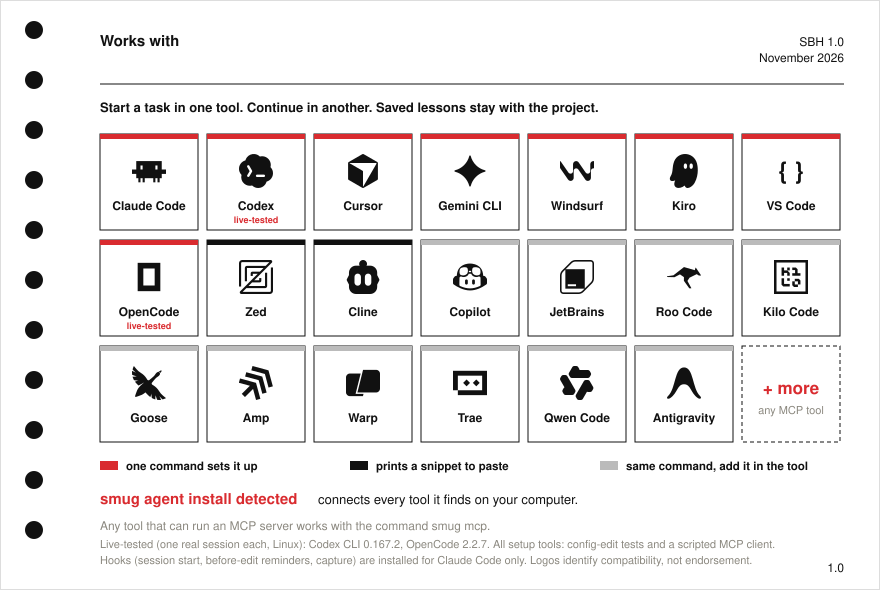

<p align="center"></p>

<p align="center">
<a href="https://github.com/OnurByte/smugbrain/releases/latest"></a>
<a href="https://github.com/OnurByte/smugbrain/actions/workflows/ci.yml"></a>


</p>

# smugBrain: local-first memory for AI coding agents

**smugBrain** gives Claude Code, Codex, Cursor, Gemini CLI and other MCP tools a memory you own: plain Markdown notes plus one small binary, `smug`. It records decisions **with their sources**, never returns a decision that has been replaced, reminds your agent of **what already failed before it edits a file**, shows you **what a change will break before you make it**, and refuses to apply it if your own test questions start failing. No account. No cloud. No telemetry. Nothing to compile. Public domain.

Better than your brain. Objectively.

## Install

### Prompt install

Paste this into your AI agent (Claude Code, Codex, Cursor, Gemini CLI...). It does the rest and asks before it changes anything.

```text
Install smugBrain on this computer from https://github.com/OnurByte/smugbrain.
Detect my operating system, download the matching binary from the latest GitHub release,
verify it against SHA256SUMS, and put it on my PATH. Then run `smug init my-brain`.
Next run `smug agent install detected --dry-run` and show me exactly what it would change;
only run it for real after I say yes. Never overwrite existing files, never ask me for secrets,
and finish by telling me what you installed, what you skipped, and what I should do next.
```

### Command install

Each block has a copy button in its top-right corner on GitHub. The installer verifies the SHA-256 before it installs anything.

  **macOS, Linux (x86-64, ARM) and Haiku**

```bash
curl -fsSL https://raw.githubusercontent.com/OnurByte/smugbrain/main/install.sh | sh
```

 **FreeBSD** (uses the built-in `fetch`; with `curl` installed the line above works too)

```bash
fetch -qo - https://raw.githubusercontent.com/OnurByte/smugbrain/main/install.sh | sh
```

 **Windows** (PowerShell)

```powershell
irm https://raw.githubusercontent.com/OnurByte/smugbrain/main/install.ps1 | iex
```

Or download a binary from the **[Releases page](https://github.com/OnurByte/smugbrain/releases/latest)**: Linux, macOS (Intel and Apple silicon), Windows, FreeBSD and Haiku, each listed in `SHA256SUMS`.

## Connect your coding tool

```bash
smug init my-brain          # your memory: folders, rules, .gitignore
cd my-brain
smug agent install detected # connects every supported tool it finds on this computer
```

Restart your coding tool, then ask it: *"Use smug to recall what we decided about the database."* Nothing is overwritten: smug merges one entry into each tool's config, refuses files it cannot parse, and `--dry-run` shows what it would do first.

### Works with

<p align="center"></p>

Copy the line for your tool:

```bash
smug agent install claude-code
```

```bash
smug agent install codex --global
```

```bash
smug agent install cursor
```

```bash
smug agent install gemini
```

Also: `windsurf --global`, `kiro`, `vscode`, `opencode`. Zed and Cline print a snippet to paste. Any other MCP tool: use the command `smug mcp`.

<details>
<summary><b>What "supported" means here</b></summary>

Every setup tool above has automated tests for how smug edits its config, and the MCP server is tested with a scripted client over stdio (`smug agent doctor` runs the same check on your machine). We have **not** yet run a live session in each tool, so we do not claim that. Lifecycle hooks (session start, before-edit reminders, capture) exist for Claude Code only; the other tools get the memory tools. `smug agent list` prints the exact test level per tool.

</details>

<details>
<summary><b>What your agent can do (six tools)</b></summary>

**`smug_recall`** (relevant, still-valid memory), **`smug_check`** (is this decision still valid?), **`smug_explain`** (source, dates, history), **`smug_impact`** (what depends on it), **`smug_propose`** (save something worth remembering), **`smug_feedback`** (did it help?). Four are read-only. `smug_propose` only writes an **inert candidate**: nothing becomes memory until *you* run `smug review` and `smug promote`. Start the server with `smug mcp --read-only` to take the write tools away entirely.

</details>

## Numbers

<p align="center"></p>

## Compare

How smugBrain compares with avenoxbeyin, obsidian-second-brain, hafiza-os, Graphiti and mem0. Facts come from each project's own repository and README, checked 2026-11-12. They lead in places and the card says where.

<p align="center"></p>

<details>
<summary><b>What it does: the commands</b></summary>

```bash
smug search rust karar                 # find notes; replaced decisions never come back
smug decide postgres --source adr-7 --topic db --files src/database.rs < why.txt
smug check postgres                    # CURRENT / STALE / CONFLICTED / UNSUPPORTED
smug fail pool-cache --method "cache the pool" --reason "leaked connections" --file src/database.rs --commit head --test-result "3 failed" --verified yes
smug warn "let's cache the pool"       # it has failed before: why, in which commit, was it verified
smug at 2026-11-03 database            # what was valid and known on that day
```

**The learning loop (nothing becomes memory without you)**

```bash
smug capture --transcript session.jsonl    # a session, secret-shaped lines redacted
smug learn 000-inbox/captures/x.md --model "claude -p" --propose   # candidates, all inert
smug review                                # what is waiting, with conflicts flagged
smug promote use-redb --source adr-9       # you decide; refuses conflicts and missing sources
```

**Change a decision safely**

```bash
smug patch postgres --new-id cockroach --source adr-9 < why.txt   # proposes, applies nothing
smug impact postgres                   # every note that depends on it
smug eval 1 --model "claude -p"        # your questions, before and after, with a real model
smug eval --ab --model "claude -p"     # memory on vs memory off: what is it actually worth?
smug apply 1                           # refuses if a question that passed now fails
```

Everyday safety: `smug write note.md --expect <sha256|new>` (atomic; refuses if the file changed under you), `smug backup` (scans exactly what is staged, stops on any secret), `smug doctor` (health check, crash recovery, index repair), `smug bench`, `smug receipts` (what each agent session was shown and used). Full list: run `smug` with no arguments.

</details>

<details>
<summary><b>FAQ</b></summary>

**What problem does it solve?** AI agents forget, and worse, they confidently use decisions that were replaced months ago, or retry a fix that failed last week. smugBrain keeps every decision and every failed attempt with its source, commit and test result, and refuses to hand a stale one back.

**Does it need the cloud, an account or an API key?** No. It makes no network calls. Your notes are Markdown files in a folder.

**Can two agents use the same memory at once?** Yes. Each agent session keeps its own state (hashed session id), writes are hash-checked so one cannot silently overwrite another, and every write is journalled.

**Can my agent change my memory by itself?** It can propose, never promote. Promotion, supersession and patch-apply are human CLI steps, and are not exposed over MCP at all.

**Does it work with Obsidian?** Yes. The vault is a normal Obsidian-compatible folder; `[[wikilinks]]` count as dependencies in `smug impact`.

**Can it test what a model would answer?** Yes, with your own model command: add `answer_contains` / `answer_absent` to eval cases and run `smug eval 1 --model "claude -p"`. The model runs in a throwaway directory with a timeout and an output cap, never inside your vault. `smug eval --ab` compares the same model with and without your memory.

**What if smug crashes halfway through a change?** Every step is journalled and idempotent. `smug doctor` (or re-running `smug apply`) finishes an interrupted apply; a damaged search index is rebuilt from the Markdown automatically.

**Is it safe to back up?** `smug backup` scans exactly what is staged and stops on private keys, tokens, API keys, `password:` lines and recovery phrases. Anything secret-shaped belongs in `.secrets/`, which is never committed or indexed.

**Is it really a single binary?** Yes: pure Rust (redb for state, Tantivy for search), no Python, no Node, no C library, no server.

**Does it search by meaning?** Built-in search is keyword search with Turkish-friendly folding (`isik` finds `ışık`). `smug search --deep` hands the query to [QMD](https://github.com/tobi/qmd) for semantic search when you have it installed.

</details>

<details>
<summary><b>Under the hood</b></summary>

Markdown notes. State in [redb](https://github.com/cberner/redb), search in [Tantivy](https://github.com/quickwit-oss/tantivy). Every write is journalled to `history/events.jsonl`, which lives in git: delete `.smug/` and nothing is lost. Guarantees, data formats, permissions and limits: [docs/design.md](docs/design.md). Release history: [CHANGELOG.md](CHANGELOG.md).

</details>

<details>
<summary><b>Limits (read this before you rely on it)</b></summary>

- The model in `eval` is whatever command you supply; smug bundles none and the command runs with your privileges (throwaway directory, timeout and output cap, but not a sandbox).
- `bench` and `eval` run on your own cases; there is no independent public benchmark.
- Hooks exist for Claude Code only. Other tools get the MCP tools.
- Automatic feedback is a heuristic: a surfaced note counts as used when its file name appears in what the assistant wrote or did.
- Live sessions in each listed tool have not been run; see "What supported means here".

</details>

## Contributing

Pull requests, bug reports and test cases are welcome: see [CONTRIBUTING.md](CONTRIBUTING.md). Good first contributions: a test for a platform quirk, a new secret pattern with a test, a live check of a tool in the table.

<a href="https://github.com/OnurByte/smugbrain/graphs/contributors"></a>

## License

Public domain ([Unlicense](LICENSE)). Security: [SECURITY.md](SECURITY.md). Design: NASA Graphics Standards Manual NHB 1430.2 (1976). Logos identify compatibility and are not endorsements; each belongs to its owner.
