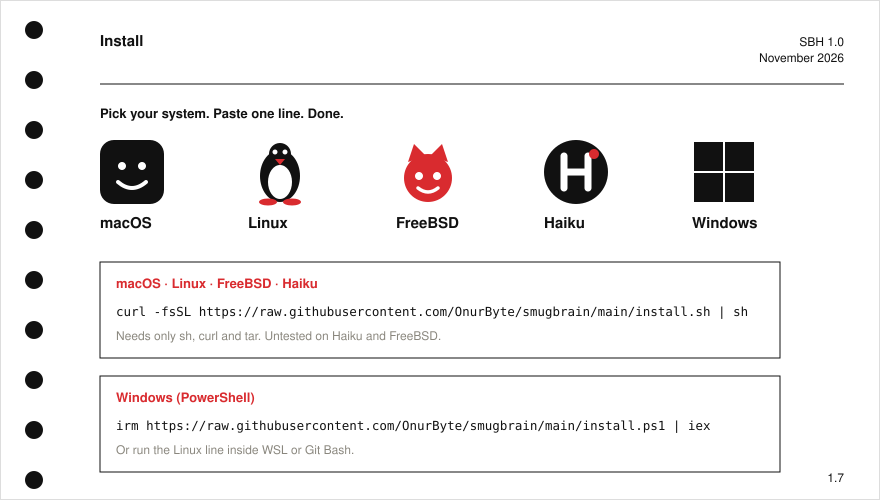

<a href="README.tr.md">Türkçe</a> · <a href="LICENSE">Public domain</a>

**smugBrain** is a brain upgrade that is, frankly, better than yours. Plain Markdown notes, a Rust core (in progress), and agents (Claude Code, Codex, Hermes) that remember what you did yesterday. No account. No cloud.

## Install

## Compare

## Numbers

## How it works

## Roadmap

Details: [docs/roadmap.md](docs/roadmap.md)

## License

Design: NASA Graphics Standards Manual NHB 1430.2 (1976).
