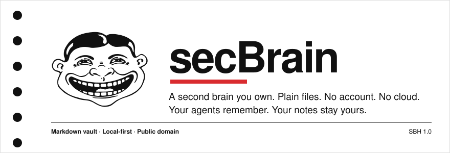
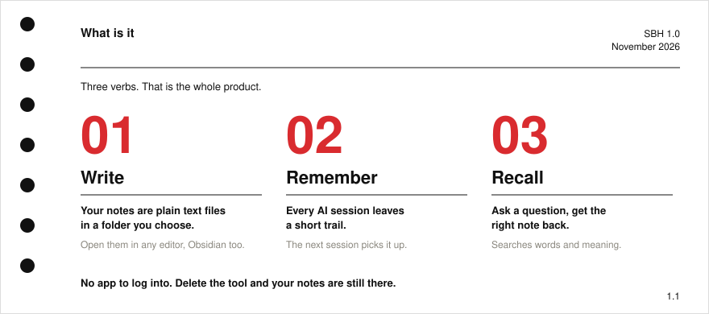
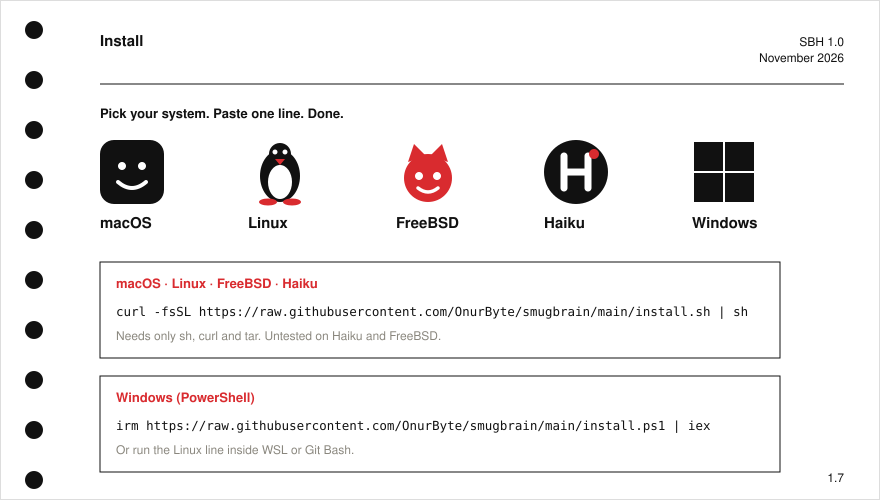
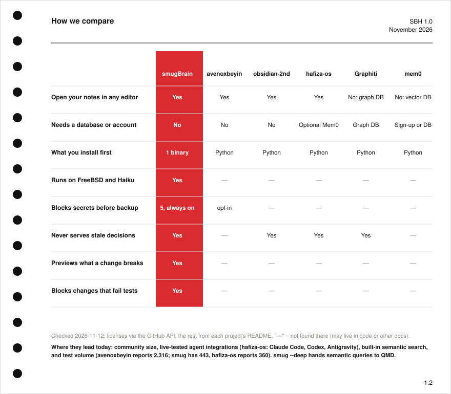
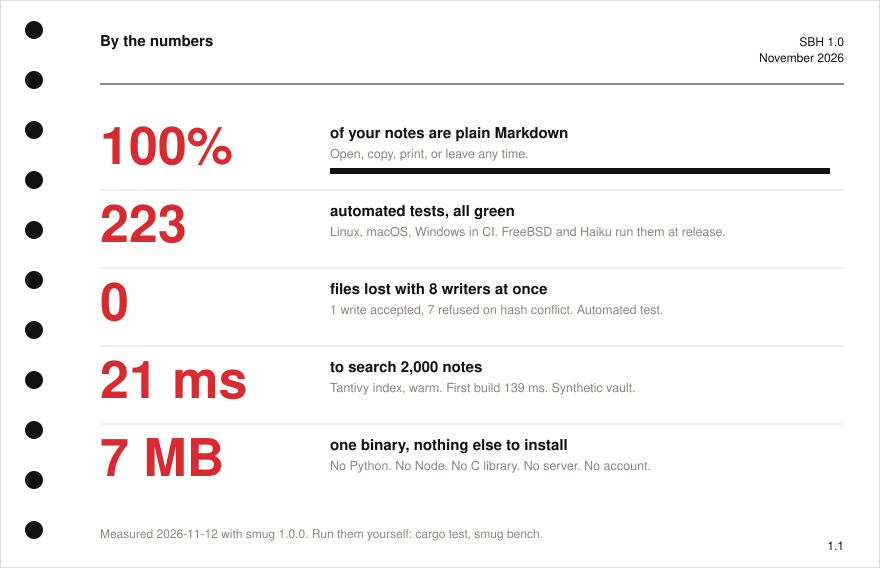
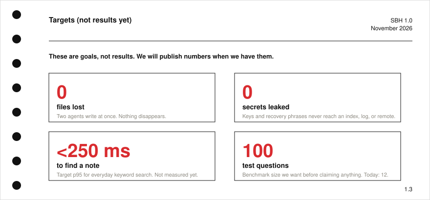
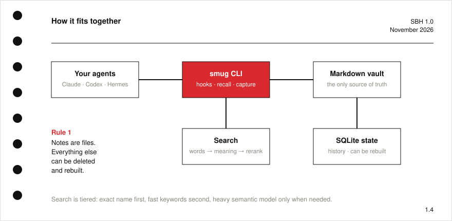
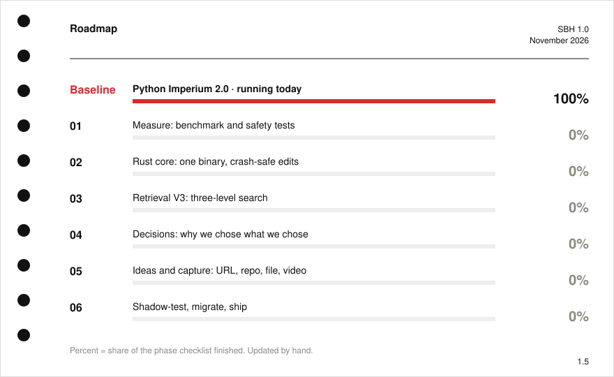
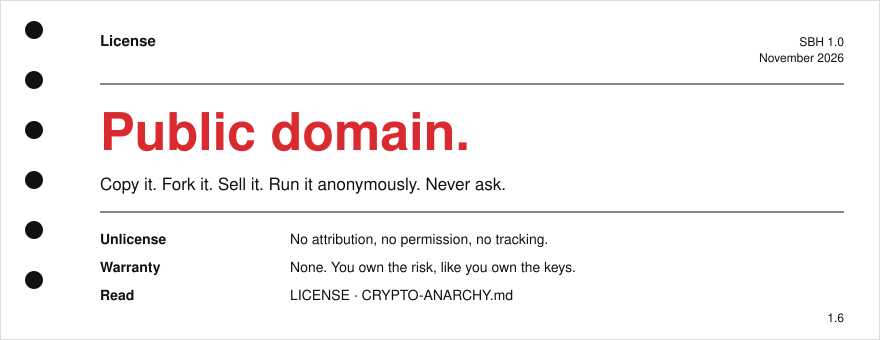

<a href="README.md">English</a> · <a href="LICENSE">Kamu malı</a>

**smugBrain**, açıkçası seninkinden daha iyi bir beyin yükseltmesi. Düz Markdown notlar, Rust çekirdek (yapım aşamasında) ve dünü hatırlayan ajanlar (Claude Code, Codex, Hermes). Hesap yok. Bulut yok.

## Kurulum

## Karşılaştırma

## Sayılar

## Nasıl çalışır

## Yol haritası

Ayrıntı: [docs/roadmap.md](docs/roadmap.md)

## Lisans

